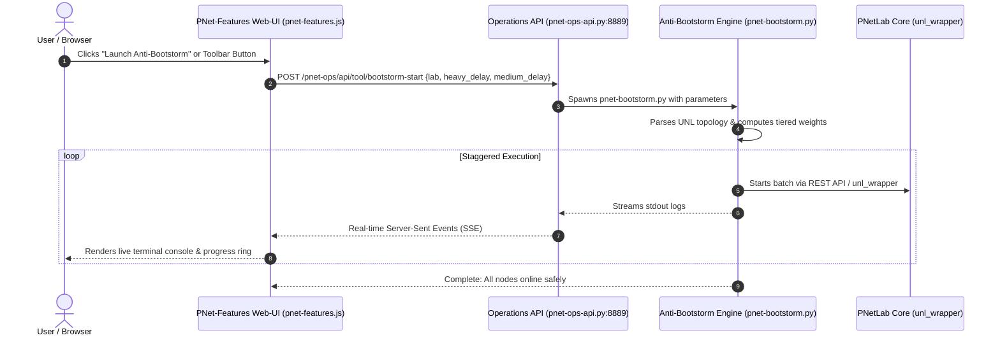

# PNetLab Anti-Bootstorm Staggered Node Startup Engine

**Complete Architecture, CLI Reference & Web-UI Operations Runbook**  
*Platform: Ubuntu 24.04 / 26.04 LTS • Platform Engine: PNetLab v8 (`6.8.93resolute1`)*  
*Module: `Custom-Features` • Component Script: [`pnet-bootstorm.py`](../scripts/pnet-bootstorm.py)*

---

## 1. Executive Summary & Problem Statement

In large-scale network topologies (20–100+ virtual nodes), powering on all appliances simultaneously triggers a catastrophic phenomenon known as a **Bootstorm**:
1. **CPU & Thread Lockup**: Modern virtual appliances (e.g., Cisco Catalyst 8000v, IOS-XRv 9000, Juniper vMX, Windows 11) run intensive hardware detection, crypto initialization, and memory self-tests during initial boot, spiking host vCPUs to 100%.
2. **Disk I/O Bottleneck & QEMU Wait-States**: Disk read concurrency causes severe storage I/O queuing, triggering QEMU watchdog timeouts and guest kernel panics.
3. **Out-of-Memory (OOM) Panics**: Without memory deduplication settling time, starting heavy VMs simultaneously triggers Linux kernel OOM kills before Ultra-KSM can merge identical pages.

The **Anti-Bootstorm Staggered Node Startup Engine** ([`pnet-bootstorm.py`](../scripts/pnet-bootstorm.py)) completely resolves this by automatically analyzing the target lab's XML/UNL topology, classifying every node by resource weight into three discrete tiers, and launching them in an intelligent, staggered execution pipeline.

```
┌─────────────────────────────────────────────────────────────────────────────┐
│                 ANTI-BOOTSTORM THREE-TIER PIPELINE                          │
├──────────────────────────┬──────────────────────────┬───────────────────────┤
│ Tier 1: Heavy Nodes      │ Tier 2: Medium Nodes     │ Tier 3: Light Nodes   │
│ (Cat8000v, XRv9k, Win)   │ (CSR1000v, vEOS, vIOSL2) │ (IOL, VPCS, Docker)   │
├──────────────────────────┼──────────────────────────┼───────────────────────┤
│ • Stagger Delay: 18s     │ • Stagger Delay: 10s     │ • Stagger Delay: 0s   │
│ • Batch Size: 2–3 nodes  │ • Batch Size: 4 nodes    │ • Concurrent launch   │
│ • Console Port Polling   │ • Console Port Polling   │ • Instant boot        │
└──────────────────────────┴──────────────────────────┴───────────────────────┘
```

---

## 2. Node Classification Architecture

Nodes are dynamically categorized based on their template identifiers, memory allocation, and appliance family:

| Tier | Appliance Examples | Resource Profile | Stagger Interval | Batch Size |
| :--- | :--- | :--- | :--- | :--- |
| **Tier 1 (Heavy)** | Cisco Catalyst 8000v (`c8000v`), Cisco 8000 (`xrd`), IOS-XRv 9000 (`xrv9k`), Windows 11 / Server (`win`), Juniper vMX (`vmx`), FortiGate (`fortinet`) | $\ge 4\text{ GB RAM}$, 2–4 vCPUs, heavy storage I/O | **18 seconds** | 2–3 nodes |
| **Tier 2 (Medium)** | Cisco CSR1000v (`csr1000v`), Arista vEOS (`veos`), Cisco IOSv / IOSvL2 (`vios`, `viosl2`), Linux Desktops (`linux`) | $1\text{–}3\text{ GB RAM}$, 1–2 vCPUs | **10 seconds** | 4 nodes |
| **Tier 3 (Light)** | Cisco IOL / IOU (`iol`), VPCS (`vpcs`), Alpine Linux, Docker Containers (`frr`, `openbmp`) | $< 512\text{ MB RAM}$, micro-footprint | **Instant** | Unlimited concurrent |

---

## 3. Command-Line Reference (`pnet-bootstorm`)

The engine is installed into `/usr/local/bin/pnet-bootstorm` and can be executed directly from the terminal or SSH session:

### Common Syntax:
```bash
sudo pnet-bootstorm --lab <LAB_PATH> [OPTIONS]
```

### Parameter Reference:

| Flag | Description | Default |
| :--- | :--- | :--- |
| `--lab <PATH>` | Target lab path relative to `/opt/unetlab/labs/` (e.g. `/CCIE_Enterprise.unl`) | *Required* |
| `--heavy-delay <SEC>` | Delay in seconds between starting Heavy node batches | `18` |
| `--medium-delay <SEC>` | Delay in seconds between starting Medium node batches | `10` |
| `--dry-run` | Simulates and prints the calculated execution order without booting nodes | `False` |
| `--probe-console` | Actively polls node TCP console ports until the guest OS socket accepts connections | `False` |
| `--ksm` | Forces an immediate Ultra-KSM deduplication scan after each batch to free RAM | `False` |
| `--token <COOKIE>` | Admin session token (auto-detected from database if omitted) | Auto |
| `--host <IP>` | PNetLab Controller API address | `127.0.0.1` |

### Usage Examples:

1. **Simulation (Dry-Run)**:
   ```bash
   pnet-bootstorm --lab /CCIE_Practice.unl --dry-run
   ```

2. **Standard Staggered Startup**:
   ```bash
   sudo pnet-bootstorm --lab /SDWAN_Enterprise.unl
   ```

3. **High-Density Production Startup (Console Probing + Ultra-KSM)**:
   ```bash
   sudo pnet-bootstorm --lab /DataCenter_SpineLeaf.unl --probe-console --ksm --heavy-delay 20
   ```

---

## 4. Web-UI Operations Center Integration

The Anti-Bootstorm Engine is integrated as a first-class feature across the PNetLab Web-UI:



### Web-UI Entry Points:
1. **PNet-Features Dashboard (Pane 0)**:
   * Navigate to `https://<PNET_IP>/main/#/pnet-features`.
   * **Pane 0** displays the **Anti-Bootstorm Staggered Node Startup Engine**.
   * Provides dropdown lab selection, slider controls for heavy/medium delays, dry-run toggles, and live SSE streaming logs.
2. **Main Workspace Toolbar**:
   * An interactive **`🚀 Anti-Bootstorm`** button is automatically mounted onto the main lab list header.
3. **Lab Preview Modal**:
   * Selecting any `.unl` file in the file explorer mounts the **`BOOTSTORM`** quick-launch action directly alongside standard start controls.

---

## 5. Operations Center REST API

The backend API daemon ([`pnet-ops-api.py`](../scripts/pnet-ops-api.py)) exposes the bootstorm engine over HTTP:

* **Endpoint**: `POST /pnet-ops/api/tool/bootstorm-start`
* **Headers**: `Content-Type: application/json`, `Cookie: token=<ADMIN_TOKEN>`
* **Payload**:
  ```json
  {
    "lab": "/MyLab.unl",
    "heavy_delay": 18,
    "medium_delay": 10,
    "dry_run": false,
    "probe_console": true,
    "ksm": true
  }
  ```
* **Response**: Real-time event-stream (`text/event-stream`) streaming each node's startup status, IP, console port, and current RAM reduction metrics.

---

## 6. Verification & Troubleshooting

* **Verify CLI Installation**:
  ```bash
  which pnet-bootstorm
  pnet-bootstorm --help
  ```
* **Verify System Health**:
  ```bash
  sudo pnet-dry-test
  ```
  *(Checks Probe 2, Probe 5, and Probe 10 to ensure watchdog, web-ui, and optimizer compatibility).*
