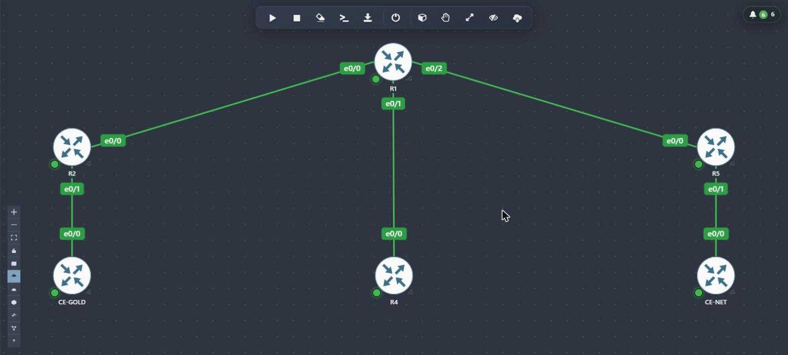
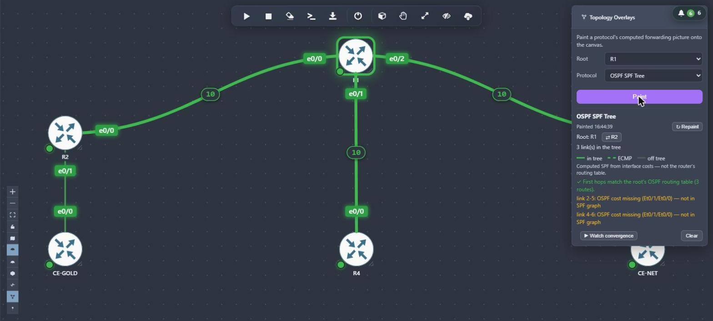
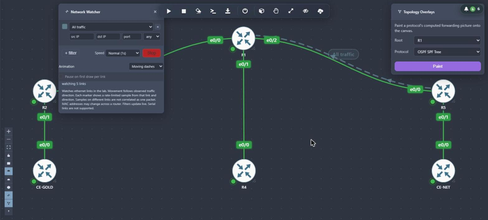
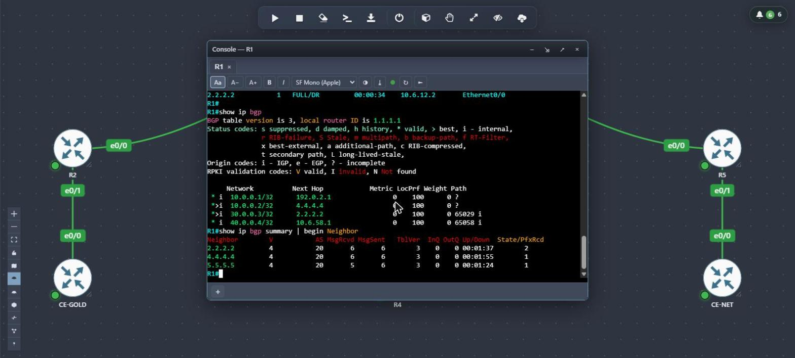
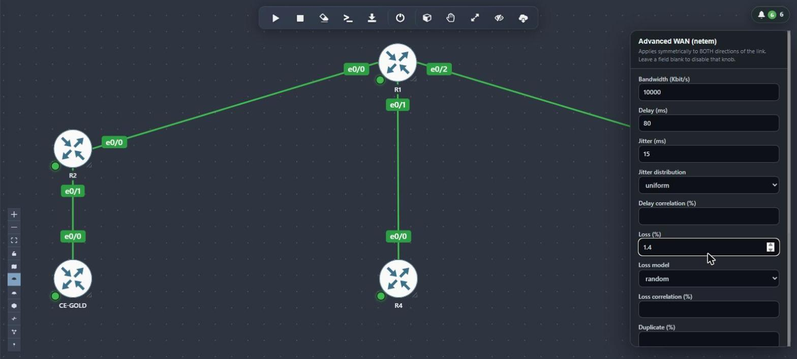
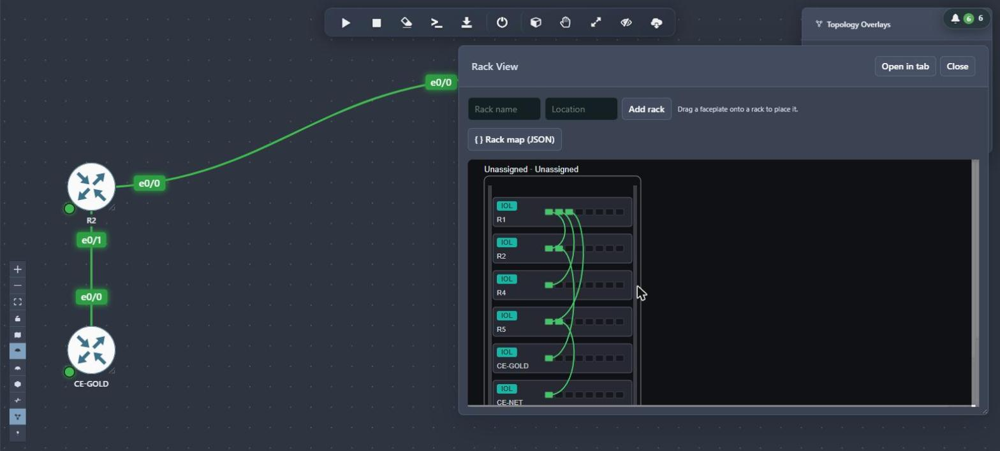
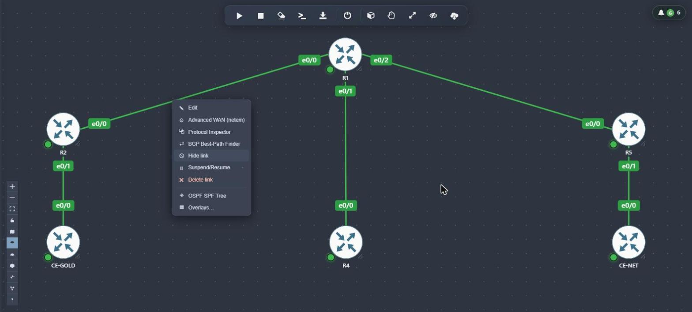

<!--
  DRAFT, not published. Screenshots live in docs/img/. Commit that folder with the README.
-->

<div align="center">

# PNetLab v8

**Build, run and break real network labs in your browser.**
Routers, switches, firewalls and servers on one canvas, with live protocol overlays, link impairment and in-browser consoles.


[Download](#downloads) · [Install](#installation) · [Workstation edition](#install-on-a-desktop-workstation-edition) · [Updating](#updating) · [Changelog](CHANGELOG.md)



</div>

---

This repository is a landing page for **PNetLab v8** downloads and upgrade instructions. It does not host the application source.

The signed network-install channel serves `6.8.93resolute1`. See the [changelog](CHANGELOG.md) for what changed.

## Why PNetLab

- **Everything in the browser.** Build the topology, open consoles and inspect protocols without installing a client.
- **See what the network is doing.** Paint the OSPF shortest-path tree onto the canvas, watch live link traffic, or view the lab as a cabled rack.
- **Break it on purpose.** Add delay, jitter, loss and bandwidth limits to any link.
- **Runs where you want it.** A VM, a dedicated server, or natively on your own Ubuntu desktop.
- **Self-hosted.** Your labs and images stay on your machine.

## See it in action

| | |
|---|---|
|  |  |
| **Protocol Painter.** Paint the OSPF tree onto the topology. It checks the result against the router's own routing table. | **Network Watcher.** Watch real traffic move across links, filtered by IP and port. |
|  |  |
| **In-browser consoles.** A real IOS-XE router, here showing a source-based RTBH route next to normal BGP routes. | **Link impairment.** Bandwidth, delay, jitter, loss and more, applied symmetrically per link. |
|  |  |
| **Rack View.** Lay the lab out in equipment racks with faceplates and cabling. | **Per-link tools.** Advanced WAN, Protocol Inspector, BGP Best-Path Finder, OSPF SPF Tree and overlays. |

## Features

| Area | What you get |
|---|---|
| **Canvas** | Drag-and-drop topology, status LEDs, link labels, traffic glow, grid, dark theme, minimap, sketching |
| **Consoles** | In-browser HTML5 consoles (telnet, VNC, RDP), or native telnet, VNC, RDP and Wireshark handlers |
| **Link control** | Advanced WAN (netem) impairment, suspend/resume per link, per-node pause |
| **Protocol tools** | OSPF SPF Tree, BGP Best-Path Finder, Protocol Inspector, Protocol Painter, packet capture |
| **Observability** | Network Watcher live traffic, per-node resource graphs, Rack View, system status |
| **Lab building** | Startup configs, config export, Lab PKI, SD-WAN Lab Builder, AI Lab Builder |
| **Special labs** | Wi-Fi Painter, RoCE Lab |
| **Images and nodes** | Image Manager, Docker devices, custom lab images |

## Which install is right for me?

| | **Network install** | **OVA** | **Workstation edition** |
|---|---|---|---|
| Best for | A dedicated server or VM you manage | A quick import into a hypervisor | Your own Ubuntu or Xubuntu desktop |
| Starts from | Fresh Ubuntu 26.04 server | Prebuilt autoinstaller VM | Existing Ubuntu or Xubuntu 26.04 desktop |
| Updates | `sudo pnetlab-update` | `sudo pnetlab-update` | Re-run a newer bundle's `install.sh` |
| Changes your system | Yes, it owns the host | Yes, it is its own VM | No. Leaves GRUB, DNS, SSH and apt alone |
| Native consoles and Wireshark | Yes | Yes | Yes |
| Needs a spare wired port for bridging | Depends on the host | Depends on the hypervisor | Yes, for real L2 bridging |

## Downloads

| Artifact | Description | Link |
|---|---|---|
| Network Install Script | Hands-off installer for a fresh Ubuntu 26.04 (27H1 "Resolute") host. Pulls and installs the latest PNetLab v8 release over the network. | [download](https://codeberg.org/api/packages/netkillui/generic/pnetlab-core-assets/0.channel/pnetlab-network-install-latest.sh) |
| OVA (autoinstaller) | Minimal Ubuntu 26.04 image with an unattended autoinstaller. Boots and installs PNetLab v8 itself. | [download](https://mega.nz/file/uNAz3JDb#CQA93KkaU3XrCs6EIosChOjYonn1W4ELgnLm7NcZ2Wg) |
| Desktop Install Bundle | Installs PNetLab v8 on an Ubuntu Desktop workstation environment on bare metal. Tested on Ubuntu 26.04 Desktop and Xubuntu 26.04 Desktop. Xubuntu is recommended for its lighter resource footprint. Dual boot alongside Windows or an external SSD setup works. | [download](https://mega.nz/file/CIQSWIqC#S-BbPFLLDrj_7xt-DVCUXQ24RH10xBrIhqzZd9-HN6I) |
| Custom Images | Lab images for Wi-Fi access point, client, OpenBMP, and RoCEv2 client with RXE configured. | [download](https://mega.nz/folder/3dQ3SIhL#MX518yID5GuuLUkDbCRa0g) |

## Requirements

- 64-bit host with hardware virtualization (Intel VT-x or AMD-V)
- Light use: 4 vCPU, 8 GB RAM, 40 GB disk. Scale up for larger labs.
- Ubuntu 26.04 LTS for the network install method

## Installation

### Option 1: Network install (recommended)

On a fresh Ubuntu 26.04 server:

```bash
curl -fsSL https://codeberg.org/api/packages/netkillui/generic/pnetlab-core-assets/0.channel/pnetlab-network-install-latest.sh | sudo bash -s -- --yes --release latest
```

The script partitions storage, installs dependencies and pulls the latest package.

### Option 2: OVA (autoinstaller)

1. Download the OVA.
2. Import it into VMware Workstation, ESXi or VirtualBox.
3. Power on. The autoinstaller partitions the disk, installs Ubuntu 26.04 and PNetLab, and asks only for a DHCP or static IP choice.
4. After the reboot, open `https://<host-ip>/`.

### Install on a desktop (Workstation edition)

Run PNetLab as a native app on the Ubuntu or Xubuntu desktop you already use. No VM, no appliance, no reinstall.
This is a **one-time install**: it does not rewrite your GRUB, DNS, SSH or apt settings, and there is no auto-update channel.

**You need**

- Ubuntu or Xubuntu Desktop **26.04**, already installed (Xubuntu is lighter and recommended)
- A 64-bit CPU with VT-x or AMD-V enabled in the BIOS
- 4 vCPU, 8 GB RAM and 40 GB free disk for light use. More RAM means bigger labs.
- Internet access during install, because apt fetches MySQL, PHP-FPM and other Ubuntu dependencies
- `sudo` rights
- A **spare Ethernet or USB-Ethernet port** if you want real bridged networking (`pnet0`)

**Install**

1. Download the **Desktop Install Bundle** from the [Downloads](#downloads) table.
2. Extract it somewhere world-readable such as `/opt`. Do not use `/root`, because apt cannot read a local repo there.

   ```bash
   sudo mkdir -p /opt/pnetlab-ws && sudo tar -xzf ~/Downloads/pnetlab-workstation-bundle-*.tar.gz -C /opt/pnetlab-ws
   cd /opt/pnetlab-ws/pnetlab-workstation-bundle-*/
   ```

3. Run the installer:

   ```bash
   sudo ./install.sh
   ```

   It adds the bundle as a temporary local apt source, installs PNetLab, Docker and the supporting packages, then removes the temporary source.
4. Open **https://localhost/**, sign in, and change the default password right away. Plain `http://` redirects to HTTPS.

**What you get on the desktop**

- A desktop shortcut for the web UI
- Native console handlers: `telnet://`, `vnc://`, `rdp://` and `capture://` open your local terminal, Remmina, FreeRDP and Wireshark
- Docker-based nodes such as Wireshark capture and Wi-Fi spike, pulled from Docker Hub on first use

**Networking notes**

- `nat0` follows your current default route, so lab nodes get internet through whatever you are on, including Wi-Fi.
- Nodes on `nat0` can be reached from your own browser at their private IP.
- Real L2 bridging (`pnet0`) needs a dedicated wired port. Infrastructure-mode Wi-Fi cannot bridge. This is a Wi-Fi limitation, not a PNetLab one.

**Not supported on the Workstation edition**

- Running next to the appliance `pnetlab` package. The installer refuses if it finds `pnetlab`, `eve-ng` or similar.
- In-place updates through `pnetlab-update`. To upgrade, download the newer bundle and run its `install.sh` again.

**Uninstall**

```bash
sudo apt purge pnetlab-workstation pnetlab-docker-workstation
```

**Troubleshooting**

| Symptom | Likely cause |
|---|---|
| `install.sh` says a conflicting package is installed | Remove it first (`sudo apt purge <pkg>`), or stay on the appliance |
| apt dependency errors | No internet, or a blocked Ubuntu mirror |
| Windows node shows a black RDP screen | The guest requires NLA. Save a username and password on the node, or turn off "Require NLA" in the guest |

## Updating

- **Built-in update:** `sudo pnetlab-update` checks the release channel and applies the newest package. Read the changelog first on production hosts.
- **Manual upgrade** (if `pnetlab-update` is unavailable):
  1. Back up `/opt/unetlab` (or your configured lab path) and your custom node images.
  2. Download the target release package.
  3. Run `sudo dpkg -i pnetlab_<version>_amd64.deb`, then `sudo apt-get -f install`.
  4. Reboot and verify the web UI and your running labs.
- **Workstation edition:** download the newer bundle and run its `install.sh` again.

## Support

Open an issue in this repository's tracker. Please include your install type, the PNetLab version and what you expected to happen.

## License

See the license terms distributed with the PNetLab v8 package.
